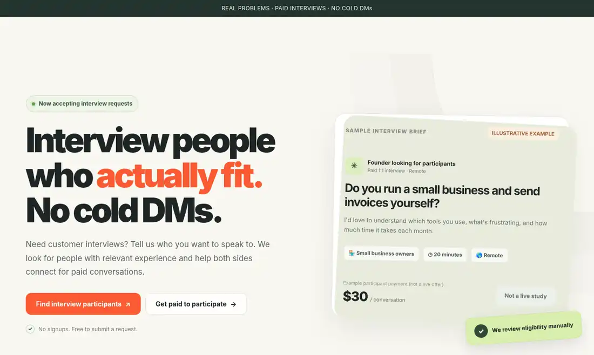

  
  <h1>sandwich</h1>
  
Website for requesting paid customer interviews and registering interest in participating.

  

    
    
    
    
  

## Current behavior

- Researchers submit the people they want to interview, project details, timing, and recruiting budget.
- Potential participants describe their experience and leave contact information.
- A separate privacy/contact form accepts questions and data requests.
- Netlify Forms stores submissions. The operator reviews requests and coordinates conversations manually.
- No account creation, automatic participant matching, interview scheduling, or in-app payment processing is implemented.

## Implementation

HTML, CSS, and JavaScript in the `site/` directory; hosting and form handling through Netlify. The site does not currently use a frontend framework or a separate application server.

The `site/` directory contains the website, privacy page, confirmation pages, Netlify headers, and robots.txt.

For a repository-connected Netlify deployment, set the publish directory to `site`. HTML pages can be opened locally, but form submission handling requires deployment on Netlify.

Form names: `research-requests`, `participant-interest`, and `privacy-contact`.

## Test status

One researcher-form test submission was previously confirmed in Netlify. The participant and privacy forms have not been independently confirmed with live submissions.

No participant submissions, customer data, private operating records, API keys, or credentials are included in this repository.

The repository is public. No open-source license has been assigned.
